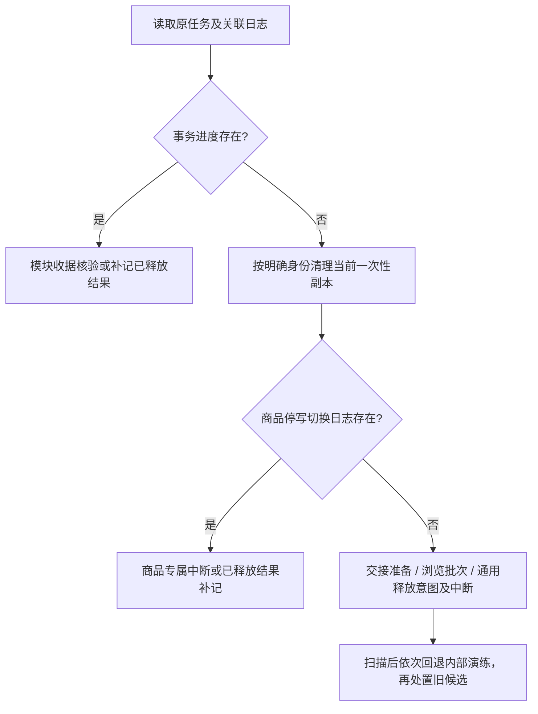

# 备份恢复生命周期、正式入口、内部演练与持久任务兼容

核对日期：2026-11-02。本文对应 ARCH-06，并同步媒体及配置内容补缺的后续交付；只说明本地实现与源码责任，不代表已发布或通过目标商城验收。业务状态以[主架构 13.1](../../../docs/design/local-computer-module-backup-upload-validation-and-consistent-overwrite-recovery-architecture.zh-cn.md)为准，实际操作参照[手册 4.2、4.4–4.15](../../../docs/design/ops/local-computer-whole-storefront-backup-upload-validation-and-paired-recovery-runbook.zh-cn.md)。

## 1. 按包范围选择恢复入口

上传后先由 [VerifyUploadedPackage / verifyAndPreview](uploaded_backup_package_authentication_scope_dispatch_and_whole_storefront_isolated_preview.go)认证和分派。`verify` 不是覆盖恢复：整站包演练整库恢复，商品包构造商品隔离候选，普通模块包先校验完整行和文件。之后的准入和动作由各自生命周期决定。

| 包范围及任务标识 | 已实现的正式路径 | 负责入口与成功终点 |
| --- | --- | --- |
| `whole_application`；`recovery_journal` 无商品子日志 | 整站数据库/媒体成对切换，随后整体对账再恢复服务 | `apply` → `awaiting_reconciliation` → `reconciliation-report` / `complete` → `completed`；失败/取消使用 `rollback`，核验原数据库和媒体后 `rolled_back` |
| `product_catalog_with_images`；`recovery_journal.product_catalog_stopped_switch` | 商品连续停写准备、切换、缓存/页面/媒体核对及正式接收 | `product-catalog-stopped-handoff-preparation` → `product-catalog-stopped-isolated-switch` → 缓存及投影核验 → `product-catalog-formal-restore-acceptance` → `product_released` / `completed` |
| `selected_business_modules` 且仅 `orders`；`order_module_restore` | 缺失终态订单及符合 v6 契约的已付款未结束订单，在原库事务补入 | `selected-module-isolated-restore-preview` → `order-module-formal-history-restore` → `released` / `completed` |
| `selected_business_modules` 且仅 `customer_service`；`customer_service_module_restore` | 保存聊天策略、完整行演练后在原库事务恢复四张会话表 | 模块预览 → `selected-customer-service-restore-choice` → `selected-customer-service-candidate-rehearsal` → `customer-service-module-formal-restore` → `released` / `completed` |
| `selected_business_modules` 且仅 `customers`；`customer_profile_module_restore` | 缺失资料和符合条件的完整缺失账号组，在原库事务补入 | 模块预览 → `customer-profile-module-formal-restore` → `released` / `completed` |
| `selected_business_modules` 且仅 `media`；`media_module_restore` | 缺失文件、媒体及已完成绑定补入；v2 可按计划修复登记一致的文件字节 | 模块预览 → `media-module-formal-restore` → `released` / `completed` |
| `selected_business_modules` 且仅 `configuration`；`configuration_site_content_restore` | 53 张内容、目录、流程/问卷、市场/汇率/税率、邮件模板/历史、会员等级及物流基础资料/包装/报关表缺失行，其他配置/登记及文件匹配为前置 | 模块预览 → `configuration-site-content-formal-restore` → `configuration_site_content_restored_still_isolated` → `configuration-site-content-reviewed-service-release` → `released` / `completed` |
| 配置其余范围、多模块组合或整站包子范围 | 尚无完整正式写入闭环 | 保留导出/上传校验及有限副本检查；不能从“可导出”“演练通过”推断全部可正式导入 |

表内动作均位于 `/api/tasks/:id/` 下；`reconciliation-report` 使用 GET，其余表内动作使用 POST。`verify` 要求上传权限，正式恢复、策略和演练动作要求恢复权限，仍须满足原包、过期、摘要及目标绑定。`online_overwrite_available=false` 表示没有通用不停写覆盖；聊天 `recorded_not_executable` 表示选择记录本身不能执行覆盖，满足新版演练契约后仍须另行调用正式恢复入口。

## 2. 各路径的责任文件与中断处置

| 生命周期 | 核心实现及持久身份 | 中断后如何继续 | 不得代用的路径 |
| --- | --- | --- | --- |
| 整站成对切换 | [整站切换与回退](paired_database_media_switch_durable_recovery_journal_and_rollback.go)、[整体对账](controlled_reconciliation_connection_window_and_business_inventory_report.go)、[整站投影契约](task_bound_external_projection_reconciliation_contract_and_required_operator_attestations.go)；`Task.Journal` 保存原/新 OID、文件移动和数据库切换状态 | 未完成切换检查日志后成对回退；切换完成后按整站对账放行。重启不自动重放 `apply`；已持久化的服务释放意图只在围栏已消失时补记终态 | `apply` 只收整站包；商品或聊天候选不能调用整体 `complete` 恢复营业 |
| 商品停写正式恢复 | [交接准备与取消](product_catalog_continuously_stopped_handoff_preparation_bound_journal_held_runtime_lease_and_verified_cancellation.go)、[切换/核对/专属回退](product_catalog_continuously_stopped_isolated_switch_independent_post_switch_inspection_and_verified_paired_rollback.go)、[正式接收](product_catalog_formal_restore_acceptance_scoped_database_ownership_transfer_and_durable_service_resumption.go)；准备记录、停写窗口和商品切换子日志分别保存 | 仅准备时重启须重新核验或专属取消；已有切换日志而未正式放行时保留隔离，使用 `product-catalog-stopped-switch-rollback` 核验成对回退；合法 `releasing_product` / `releasing_original` 意图且围栏已消失时只补记已发生的释放 | 通用 `rollback` 拒绝此子日志；通用 `release` 不能跳过交接或切换。`product_released` 终态不得用旧任务回退后续营业数据 |
| 订单原库事务恢复 | [订单准入及事务执行](order_module_formal_history_restore_atomic_rows_audit_receipt_and_recoverable_attachment_installation.go)、[正常约束 writer](order_module_missing_rows_normal_constraint_dependency_ordered_transactional_writer.go)；`order_module_restore` | 使用 `order-module-interrupted-restore-recovery`，核验同事务 SQL 审计、完整数据库/媒体及附件安装；未提交才撤回本次新增文件并核对原状态 | 不能使用整库切换/回退；不能因 SQL 提交后响应丢失再次写入或重新支付/发货 |
| 聊天原库事务恢复 | [保存策略与一次性演练](selected_customer_service_module_snapshot_bound_saved_restore_strategy_and_complete_row_candidate_rehearsal.go)、[四表正式事务](customer_service_module_formal_restore_saved_strategy_atomic_rows_audit_and_recoverable_attachment_installation.go)；`customer_service_module_restore` | 使用 `customer-service-module-interrupted-restore-recovery`，核验同事务收据和附件；共享身份、原事件处理状态及未选业务保持 | 不接收旧逐行候选 journal；不将聊天选择记录或副本直接提升为营业库 |
| 媒体原库事务恢复 | [媒体正式执行](media_module_formal_restore_atomic_registration_files_audit_and_verified_interruption_recovery.go)、[媒体资格](media_module_standalone_restore_eligibility_completed_uploads_shared_owners_and_cleanup_hazard_inspection.go)；`media_module_restore` | `media-module-interrupted-restore-recovery` 核对原 SQL 收据、原库/结果及新增文件；v2 字节修复未提交时还须核验恢复原字节，再恢复服务 | 仅登记一致可修复文件，不覆盖不同完整行或未登记冲突，不重新生成派生或执行清理；不使用候选切换或通用解除维护 |
| 客户原库事务恢复 | [客户准入及事务执行](customer_profile_module_formal_restore_atomic_rows_original_credentials_and_recoverable_interruption.go)、[身份和完整账号组契约](customer_profile_module_missing_account_cohort_financial_fact_and_existing_identity_preservation_contract.go)；`customer_profile_module_restore` | 使用 `customer-profile-module-interrupted-restore-recovery`，按原提交收据核验结果；保留当前身份、密码、积分、订阅、订单和聊天 | 不调用注册/奖励服务，不用旧余额覆盖现有账号，不把补缺等同任意客户覆盖 |
| 配置内容原库事务恢复 | [53 表准入和正常约束 writer](configuration_module_missing_site_content_scope_public_file_prerequisites_and_normal_constraint_writer.go)、[正式事务和审计](configuration_module_missing_site_content_atomic_restore_audit_and_verified_interruption_recovery.go)、[内容/缓存核对及释放](configuration_module_site_content_projection_review_bound_service_release_and_http_routes.go)；`configuration_site_content_restore` | `configuration-site-content-interrupted-restore-recovery` 按原收据核验；已提交仍保持维护，人工核对后走 reviewed-service-release；未提交核验原状态才恢复原服务 | 当前 v6 增加物流基础资料/包装/报关五表，验证原商品/SKU指纹及最终绑定归属、精确包装规格、报关代码/风险/来源；保留原邮件模板/会员等级范围，校验模板渲染/完整历史、会员区间/精确折扣，并保留原市场/汇率/税率等规则；不发邮件、不改积分或发推荐奖励；未开始的 v1–v5 预览须重演练；已开始日志仍按原审计核验。运费模板/线路/外部渠道凭据、settings、同步开关和运行租约不写；旧包有包装绑定却缺原商品/SKU指纹阻断，不联网或重算旧订单；结算税率与参考资料分开。不安装文件，不写其他配置或原事件；普通释放和中断核验不能跳过提交后人工核对；核对记录不代表自动清缓存 |

后五条共用[事务恢复日志、附件和提交核验](business_module_transactional_restore_shared_attachment_journal_atomic_receipt_and_verified_interruption_recovery.go)。每个任务只允许一种事务进度，且不与整站/商品切换日志、`StageDatabase` 或一次性副本身份混用。阶段为 `installing_files` → `committing_rows` → `rows_committed` → `releasing` → `released`。配置日志文件列表必须为空，不能借共用结构安装文件。最终 SQL 收据是判断提交是否发生的依据；本地阶段字段、请求成功日志或客户端超时均不能单独证明提交结果。

如果收据及提交后摘要匹配，订单/聊天/客户/媒体验证结果后放行；配置仍保持维护，必须有绑定当前提交结果的人工内容与缓存核对记录后才放行。没有收据时须先确认原库摘要未变，再撤回本次新增文件（媒体 v2 还须恢复原字节）并验证原媒体。无法判定则保留维护。`rolled_back` 表示本次未提交且文件处置已核验，不表示回退已提交的营业数据。`released` 合法终态不再检查或改写后续业务数据；`releasing` 且围栏已移除时只补记原完成结果。

## 3. 演练与旧候选的四种不同含义

| 路径 | 谁能启动、是否对外开放 | 身份及清理 | 与正式路径的关系 |
| --- | --- | --- | --- |
| 当前模块一次性副本 | [StartSelectedBusinessModuleIsolatedRestorePreview](selected_business_module_disposable_isolated_restore_dependency_conflict_and_preservation_preview.go) 及 `StartSelectedCustomerServiceModuleCandidateRehearsal`，有受权限约束的 HTTP 入口 | `selected_module_disposable_stage` 仅是 OID/属主受限的[清理身份](selected_business_module_disposable_stage_persisted_identity_and_restart_cleanup.go)，验证结束删除副本；不保存可切换候选 | 当前订单/聊天/客户/媒体/配置内容正式恢复的准入证据之一。报告通过后仍须重新核验并调用各自事务入口 |
| 商品内部成对切换演练 | [rehearseProductCatalogPairedSwitchAndVerifiedRollback](product_catalog_internal_paired_database_media_switch_durable_progress_and_verified_restart_rollback.go)，仅内部方法；当前启动调用均在测试中，无 HTTP 启动入口 | `recovery_journal.product_catalog_rehearsal`；必须核验回退，重启按专属方法尝试回退。失败保留日志和维护 | 与商品停写正式切换子日志不同。通用 `rollback` 为此日志保留专属分派；不能使用整站对账接收商品候选 |
| 旧客服一次性逐行候选 | [rehearseCustomerServiceSelectedRowsInDisposableTargetClone](customer_service_disposable_current_target_snapshot_clone_rehearsal_and_oid_guarded_cleanup.go)，仅内部方法；启动调用在测试中 | `customer-service-candidate-rehearsal-*` 中保存 `customer-service-disposable-candidate-database-identity.json`；仅按显式数据库身份清理，未知/损坏现场保留 | 用于旧逐行计划的内部验证；不是当前已保存策略演练，不是正式聊天执行入口 |
| 旧客服持久候选及内部成对切换 | [停写候选构造/处置](customer_service_persistent_candidate_stopped_binding_lifecycle_restart_disposal_and_maintenance_guards.go)、[内部切换及回退](customer_service_internal_isolated_paired_switch_execution_verified_rollback_and_restart_recovery.go)、[独立 journal](customer_service_independent_paired_switch_journal_binding_media_entry_identity_and_durable_validation.go)；启动调用均在测试中，无 HTTP 构造/切换/接收入口 | `customer-service-persistent-candidate-lifecycle-v1.json` 和 `customer-service-independent-paired-switch-journal-v1.json`，独立于 `Task.Journal`；切换后为 `switched_isolated_rollback_required`，回退到 `rolled_back_isolated` 后才可核验处置候选，最终 `discarded_not_switchable` | `execution_available=false`，正式接收仍关闭；不会修改原整站 `StageDatabase`。当前聊天事务恢复不依赖完成此候选的七项历史待办 |

“内部方法没有 HTTP 启动入口”不等于“无人会执行其代码”。[NewManager](independent_maintenance_manager_process_lifetime_and_executor_leases.go) 会调用重启恢复；旧记录的回退、候选处置、维护释放和 TTL 守卫仍在生产源码调用链中。旧客服计划、逐行审查和依赖诊断有对外只读/记录入口，但不对外提供上述内部构造或切换动作。

## 4. 重启分派与清理顺序

以[持久任务重启分派](independent_maintenance_persisted_task_restart_recovery_dispatch.go)的实际顺序为准，不按文件名年代或任务 `state` 字符串猜测恢复策略。

1. 每个任务先处理事务恢复进度：合法已释放记录保持；已释放围栏的持久意图补记；其余保留维护并等待相应模块恢复入口，然后跳过通用分派。
2. 清理当前模块一次性演练库，必须匹配记录 OID 和隔离属主；身份不明则保存中断状态。
3. 检查商品停写切换子日志，按商品专属规则补记已经发生的释放或保留中断，跳过通用分派。
4. 未解决的商品交接准备转为须重新核验；未解决的浏览增量排空保留原批次，旧候选失效。
5. 整站及商品旧内部演练的 `resuming` / `releasing_rollback` 按围栏及相应回退核验判断是否只补记；普通 `running` / `queued` 转中断，不自动重放业务动作。
6. 全部任务完成上述分类后，依次尝试回退商品内部成对演练、回退旧客服独立成对切换、处置旧客服持久候选、清理旧客服一次性副本。回退必须先于候选删除，失败现场继续保留。

图只概括任务内选择；旧内部演练恢复是扫描后的另一轮，不能由流程图推断可跳过源代码中的全局清理。

## 5. 普通释放、TTL 及历史实现退役

[任务操作串行入口](independent_maintenance_task_operation_serialization_and_durable_progress.go)和[维护围栏释放](independent_maintenance_application_gate_acquisition_verified_release_and_runtime_boundary_validation.go)分别检查未解决日志。普通 `release` 只用于没有活切换日志/事务恢复进度、没有未解决交接或浏览批次、旧客服候选已安全处置的任务。它不是通用的“强制恢复营业”入口；也不能手动删除围栏或改 JSON 阶段绕过核验。

[ExpireWorkCopies](resumable_bounded_upload_commit_and_work_copy_expiration.go)在维护隔离期间不清理；未解决事务、切换、交接或浏览批次不能仅因超过 TTL 消失。安全清理只处理核验后的工作副本与候选，任务/恢复日志及保留审计不以 TTL 直接删除。已经开始的恢复任务过期后仍须走自身中断恢复；过期不延长新恢复的准入资格。

“尚未正式运营”本身不能证明工作区没有历史演练日志。本次未连接实际服务器，未核对服务器活动任务，未判定旧实现可退役。未来只有在明确核对所有目标环境无活动/未决/损坏日志、启动及回退调用已迁移、旧记录兼容策略与历史证据归档完成后，才能另外删除相应实现。当前仅标明内部路径和保留理由，不新增创建入口、不迁移旧日志、不删数据库表或工作目录。

媒体剩余冲突、配置其余范围及组合继续按 DELIVERY-01–03 交付。媒体有界写入及配置首期内容补缺已复用共用事务内核，不依赖旧客服候选七项待办；也不能因共享“restore/candidate/switch”命名就套用整库切换。

## 6. 本轮核对范围

本轮仅增加本导航及关键源码职责注释；运行时函数、类型字段、JSON/摘要、权限路由、重启顺序和维护台脚本保持。核对覆盖 HTTP 动作到 Manager、五项内部启动方法的调用、持久身份到重启/释放/TTL 的反向引用；222 份 Go 文件的 398,925 个语法标记保持，五项内部启动方法合计 52 处调用均来自测试。18 项既有边界测试及 123 个子场景通过，零失败/跳过；本轮未重新执行数据库集成或真实浏览器矩阵。对应证据见[阶段登记 3.65](../../../docs/design/ops/local-computer-backup-roadmap-stage-alignment-and-target-environment-acceptance-register-2026-10-22.zh-cn.md)。未新增测试用例、未部署、未访问生产或改 Hostinger，未将既有集成测试证据当成本轮重新运行结果。

后续 ARCH-07 的[导出/正式可写/共享依赖交叉索引](business-module-export-writable-restore-and-read-only-shared-dependency-scopes.zh-cn.md)已完成，见阶段 3.66；它补充范围差异检查，不改变本导航的生命周期或兼容责任。
